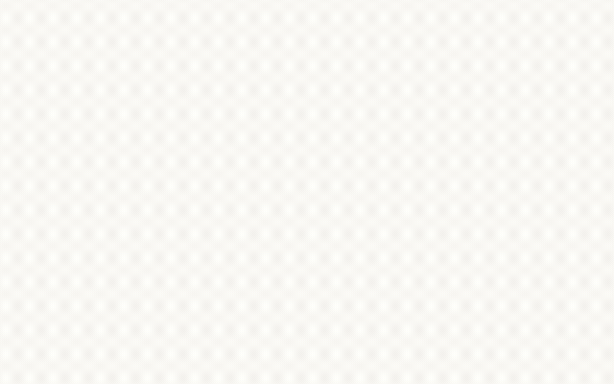
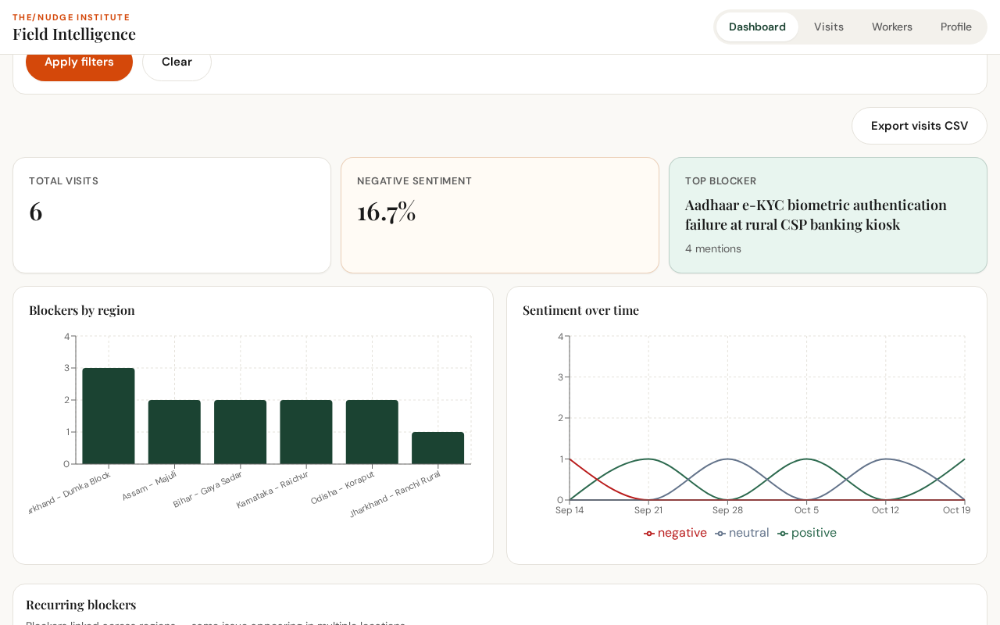
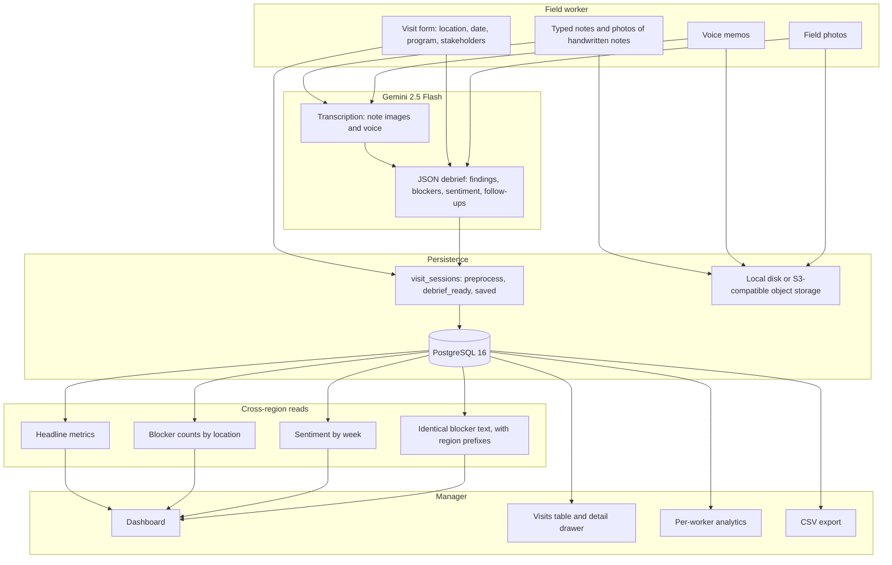
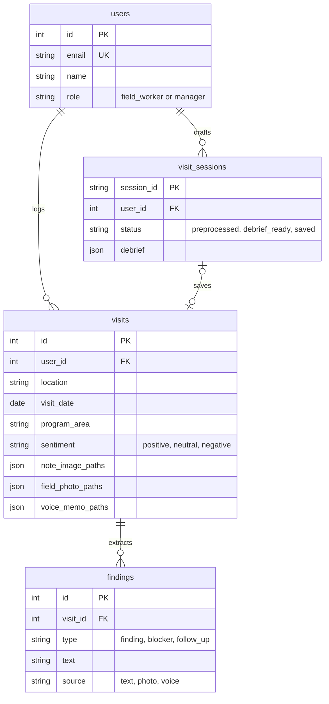

# Field Intelligence System

[](LICENSE)
[](backend/Dockerfile)
[](backend/requirements.txt)
[](frontend/package.json)
[](docker-compose.yml)

AI-structured field debriefs for NGO operations. Field workers log a visit with notes, handwritten pages, photos, and voice memos. **Gemini 2.5 Flash** turns that material into findings, blockers, community sentiment, and follow-ups. Managers read the same records as regional metrics, a sentiment trend, and blockers that repeat across blocks.

Built for **The/Nudge Institute** field operations.

<p align="center">
  
</p>

<p align="center">
  
</p>

The GIF is the recorded session: sign-in, the manager dashboard, the visits table, and the visit-detail drawer. The still is the same dashboard at full resolution (1280×800).

---

## Problem

Ground reports from field teams rarely arrive as data. A livelihood visit becomes a voice memo on the way back to the block office, a photo of a notebook page, and a paragraph in a chat thread. Program managers then reconstruct what happened by calling people. The same operational failure — a kiosk that rejects biometrics, wages that do not arrive, a vaccine fridge that is warm — shows up in three districts and still looks like three unrelated anecdotes.

Field Intelligence System keeps the capture path as light as the field and the record as strict as the dashboard:

1. A field worker submits structured metadata plus unstructured evidence.
2. Gemini transcribes handwriting and speech, then returns a JSON debrief: findings, blockers, sentiment, and follow-ups.
3. PostgreSQL stores that debrief as rows. Identical blocker sentences are counted across visits, and the region is taken from the location string, so a repeated failure is visible as one issue in several blocks.

---

## What you are looking at

The figures below are read from the recorded manager session in the GIF and the dashboard still. They are a populated database from that run. A fresh checkout starts empty; nothing in this repository seeds those six visits.

| Metric | Recorded value |
| --- | --- |
| Total visits | **6** |
| Negative sentiment | **16.7%** (1 of 6) |
| Top blocker | **Aadhaar e-KYC biometric authentication failure at rural CSP banking kiosk** — 4 mentions |
| Sentiment buckets | Weeks of 14 Sep, 21 Sep, 28 Sep, 5 Oct, 12 Oct, and 19 Oct |

Locations use `Region - Block`. The region prefix is what the recurring-blocker query reports; the bar chart titled “Blockers by region” plots the full location string (`group_by=location`).

Visits visible in the walkthrough:

| Location | Program | Visit date | Worker | Sentiment | Blockers |
| --- | --- | --- | --- | --- | --- |
| Karnataka - Raichur | Ultra-Poor Graduation | 2026-10-20 | Kiran Patel | Positive | 2 |
| Assam - Majuli | Climate-Resilient Agriculture | 2026-10-13 | Rahul Verma | Neutral | 2 |
| Jharkhand - Ranchi Rural | Youth Skill & Placement | 2026-10-06 | Ananya Sharma | Positive | 1 |
| Odisha - Koraput | Climate-Resilient Agriculture | 2026-09-29 | Kiran Patel | Neutral | 2 |
| Jharkhand - Dumka Block | Ultra-Poor Graduation | 2026-09-14 | — | Negative | 3 shown in the drawer |

The sixth visit is included in the total of 6 and is below the rows captured in the clip. Named blocks in frame are **Dumka, Koraput, Ranchi Rural, Majuli, and Raichur**, in Jharkhand, Odisha, Assam, and Karnataka.

### Dumka debrief card

Opening the visit drawer on **Jharkhand - Dumka Block** (Ultra-Poor Graduation, 2026-09-14) shows the structured card the worker saved:

- **Stakeholders:** SHG Didis (18 members), Gram Panchayat Mukhiya, Block Livelihood Coordinator
- **Sentiment:** negative
- **Field notes:** 18 households in the Dumka cluster. Goat-rearing sheds finished for 14 beneficiaries. MGNREGA wage delays of more than six weeks stalled fodder purchases. Aadhaar-seeded bank e-KYC failures at the local customer-service-point kiosk blocked direct transfers for 5 women.
- **Findings:** 14 of 18 ultra-poor households finished livestock shelters ahead of the monsoon schedule. Weekly SHG savings attendance reached 92% after digital-ledger training.
- **Blockers:** the Aadhaar e-KYC failure at the rural CSP kiosk; MGNREGA wage disbursement delayed more than 45 days, which hit household working capital; a veterinary cold-chain vaccine shortage at the block (the rest of that line sits below the frame).

That kiosk sentence is also the dashboard’s top blocker, with **4 mentions**. The same wording, written by the debrief model and stored on `findings.text`, is what links Dumka to the other blocks where the failure was logged.

---

## System architecture





### 1. Voice and multimodal debrief ingestion

The worker flow is three HTTP steps, tied together by a `visit_sessions` row (`backend/app/services/visit_processor.py`, `backend/app/services/ai.py`).

| Step | Route | What happens |
| --- | --- | --- |
| Preprocess | `POST /visits/preprocess` | Saves the form and any photos of handwritten notes under `images/notes`. Gemini transcribes each page. Typed notes and transcriptions are merged into `raw_notes`. `needs_review` is true when a page was transcribed, so the worker can correct it before the debrief. |
| Debrief | `POST /visits/debrief` | Saves field photos (`images/field`) and voice memos (`audio`). Voice is transcribed and appended to the notes. Field photos are sent to Gemini as images. The model returns JSON constrained to `DebriefResult`: `sentiment`, `findings`, `blockers`, `follow_ups`. Each item is one sentence and carries a source of `text`, `photo`, or `voice`. A retried call on a session already in `debrief_ready` returns the stored debrief. |
| Save | `POST /visits/save` | Writes `visits` plus one `findings` row per item. Session status becomes `saved`. |

Transcription and debrief can use separate Gemini keys (`GEMINI_TRANSCRIBE_API_KEY`, `GEMINI_DEBRIEF_API_KEY`) so the two quotas do not share a single limit. `GEMINI_API_KEY` is the fallback when a split key is empty. Both default models are `gemini-2.5-flash`. Temperature is 0.2. A failed JSON parse is retried once with a repair instruction.

Uploads are capped at 10 MB. Image and audio MIME types are sniffed from the bytes, not trusted from the client.

### 2. Cross-region pattern detection

There is no separate search service. After save, pattern detection is SQL over the structured rows (`backend/app/services/insights.py`).

- **Headline metrics** (`/insights/summary`): visit count, percent of visits with `sentiment = negative`, and the blocker sentence with the highest count.
- **Blockers by location** (`/insights/blockers?group_by=location`): counts of blocker rows grouped by location, program area, or exact text. The dashboard chart sums those counts per location. The chart title in the UI is “Blockers by region”.
- **Recurring blockers** (`/insights/recurring-blockers`): groups `findings` where `type = 'blocker'` by exact `text`. `count` is the number of distinct visits. `regions` are the distinct prefixes of `location` before ` - ` (`Jharkhand - Dumka Block` contributes `Jharkhand`). The panel copy is “Blockers linked across regions — same issue appearing in multiple locations.”
- **Sentiment trend** (`/insights/sentiment-trend`): counts of positive, neutral, and negative visits per day or per week (`date_trunc('week', visit_date)`). The dashboard requests weekly buckets.

Clustering is an exact match on the sentence Gemini wrote. Stable wording is what makes the Aadhaar kiosk failure line up across visits. Filters on every insight route are `date_from`, `date_to`, `program_area`, `location` (case-insensitive substring), and `worker_id`.

Schema changes ship as Alembic revisions in `backend/alembic/versions/`:

| Revision | Contents |
| --- | --- |
| `001` | `users`, `visits`, `findings`, sentiment and finding-type checks, indexes on date, program, location, sentiment |
| `002` | `visit_sessions`; visit media columns become JSON path arrays |
| `003` | `users.name` |

`alembic/env.py` reads `DATABASE_URL` from the repo-root `.env.local`. Online migrations use the same engine factory as the API, including the RDS IAM token path.

### 3. Role-based workflows

Roles are `field_worker` and `manager`, enforced with `require_role`. Auth is a JWT (`HS256`, `JWT_SECRET`, default lifetime 480 minutes) set as an httpOnly `access_token` cookie and also returned in the login body. `GET /auth/me` restores the session. Manager self-signup is rejected unless `ALLOW_MANAGER_REGISTRATION=true`.

**Field worker** (`/app/*`, bottom navigation):

1. **Log** — location, date, program area, stakeholders, typed notes and/or note photos.
2. **Review** — edit the transcription when note photos were used.
3. **Generate** — attach field photos and voice memos; wait for the debrief.
4. **Review and save** — edit findings, blockers, sentiment, and follow-ups, then persist.
5. **Visits, Photos, Audio, Settings** — own history, gallery, recordings, and account.

A session that reached `debrief_ready` can be resumed if the browser closed during generation (`GET /visits/sessions/{session_id}`).

**Manager** (`/manager/*`):

| Tab | Behavior |
| --- | --- |
| Dashboard | Date, program, and location filters. Metric cards, blocker bar chart, weekly sentiment chart, recurring-blocker table, CSV export of the filtered visits. |
| Visits | Same filters, plus client-side sort (date, location, blocker count) and sentiment filter. Row click opens the detail drawer: notes, voice, images, findings, blockers, follow-ups. |
| Workers | One row per field worker: visit count, negative-sentiment percent, most common blocker, last visit. Selecting a worker reloads metrics and recurring blockers for that person, with their visit list. |
| Profile | Signed-in manager. |

`/dashboard` renders the same page as `/manager`.

### 4. Storage

`STORAGE_BACKEND=local` (the default) writes under `UPLOAD_DIR` (default `./uploads`, resolved from the repo root). `STORAGE_BACKEND=s3` uses boto3. Set `S3_BUCKET`, `AWS_REGION`, and, for any non-AWS endpoint, `S3_ENDPOINT_URL` plus access keys. That covers AWS S3, DigitalOcean Spaces, and other S3-compatible stores such as Cloudflare R2. Keys never leave the server: `GET /media/{path}` checks that the caller may see the file, then streams the bytes.

The production layout checked into the repo is a containerized API (DigitalOcean App Platform spec in `.do/app.yaml`, image from `backend/Dockerfile`) and a Vite frontend on Vercel (`frontend/vercel.json` rewrites `/auth`, `/visits`, `/insights`, `/workers`, `/media`, and `/health` to the API). `ENVIRONMENT=production` turns on the HTTPS redirect middleware and secure cookies.

---

## Tech stack

| Layer | Choice |
| --- | --- |
| Frontend | React 19, TypeScript, Vite 6, React Router 7, Recharts |
| Backend | FastAPI, SQLAlchemy 2, Alembic, Pydantic v2, Uvicorn |
| Auth | bcrypt passwords, python-jose JWT, httpOnly cookie |
| Database | PostgreSQL 16 (`postgres:16-alpine` in Compose; host port **5433**) |
| AI | Google Gemini 2.5 Flash via `google-genai` (transcription and structured debrief) |
| Media | Local filesystem or S3-compatible object storage (boto3) |
| Deploy artifacts | `backend/Dockerfile`, `.do/app.yaml`, `frontend/vercel.json` |

---

## Repository structure

```
.
├── docker-compose.yml          # PostgreSQL 16 on localhost:5433
├── .env.example                # API environment template
├── .do/app.yaml                # DigitalOcean App Platform spec
├── docs/assets/                # README preview PNG and walkthrough GIF
├── backend/
│   ├── Dockerfile
│   ├── alembic/versions/       # 001 schema, 002 sessions and media, 003 user name
│   └── app/
│       ├── main.py             # routers, CORS, /health
│       ├── config.py           # settings from ../.env.local
│       ├── db_connect.py       # DATABASE_URL or RDS IAM token
│       ├── models/             # User, Visit, Finding, VisitSession
│       ├── routers/            # auth, visits, insights, workers, media
│       ├── services/
│       │   ├── ai.py           # Gemini transcription and debrief
│       │   ├── visit_processor.py
│       │   ├── visit_session.py
│       │   ├── insights.py     # dashboard aggregations
│       │   └── visit_export.py # CSV
│       └── storage/            # local and s3 backends
└── frontend/
    ├── .env.example
    ├── vercel.json
    └── src/
        ├── pages/              # worker flow and manager pages
        ├── components/dashboard/
        ├── api/                # typed fetch clients
        └── context/            # auth and in-progress visit flow
```

---

## Key API endpoints

Interactive schemas are served at `http://127.0.0.1:8000/docs` once the API is running. Unless noted, routes require the auth cookie or `Authorization: Bearer`.

| Method | Path | Role | Purpose |
| --- | --- | --- | --- |
| `GET` | `/health` | public | Liveness: `{"status":"ok"}` |
| `POST` | `/auth/register` | public | Create a user. `role=manager` requires `ALLOW_MANAGER_REGISTRATION=true`. Password length ≥ 10. |
| `POST` | `/auth/login` | public | Sets the `access_token` cookie and returns the token plus the user. |
| `POST` | `/auth/logout` | public | Clears the cookie. |
| `GET` | `/auth/me` | any | Current user. |
| `POST` | `/visits/preprocess` | field worker | Multipart visit form and note photos. Returns `session_id`, merged notes, `needs_review`. |
| `POST` | `/visits/debrief` | field worker | Multipart `session_id`, optional edited notes, field photos, voice memos. Returns the debrief. |
| `POST` | `/visits/save` | field worker | JSON body with `session_id` and the confirmed debrief. Returns `visit_id`. |
| `GET` | `/visits/sessions/{session_id}` | field worker | Resume an in-progress session. |
| `GET` | `/visits/mine` | field worker | Own visits. |
| `GET` | `/visits/mine/{visit_id}` | field worker | Own visit with findings. |
| `GET` | `/visits/mine/gallery` | field worker | Field photos across own visits. |
| `GET` | `/visits/mine/recordings` | field worker | Voice memos across own visits. |
| `GET` | `/visits` | manager | Paginated visits. Query: dates, program, location, `worker_id`, `page`, `page_size`. |
| `GET` | `/visits/{visit_id}` | manager | Full visit for the drawer. |
| `GET` | `/visits/export.csv` | manager | Filtered visits as CSV. |
| `GET` | `/insights/summary` | manager | Total visits, negative-sentiment percent, top blocker. |
| `GET` | `/insights/blockers` | manager | Blocker counts. `group_by` is `location` (default), `program_area`, or `text`. |
| `GET` | `/insights/recurring-blockers` | manager | Blocker text, visit count, region list. |
| `GET` | `/insights/sentiment-trend` | manager | Sentiment counts. `interval` is `week` (default) or `day`. |
| `GET` | `/workers` | manager | Field workers with per-person stats. |
| `GET` | `/media/{path}` | owner or manager | Authorized media bytes. |

Insight and visit-list filters share `date_from`, `date_to`, `program_area`, `location`, and `worker_id`.

---

## Local setup

### Prerequisites

- Docker, for PostgreSQL
- Python 3.12
- Node.js 20 or newer
- A [Gemini API key](https://aistudio.google.com/apikey)

### 1. Database

From the repository root:

```bash
docker compose up -d
```

Postgres listens on **localhost:5433** (user, password, and database are all `fieldintel`). Data lives in the `pgdata` volume.

### 2. API environment

```bash
cp .env.example .env.local          # macOS/Linux
# copy .env.example .env.local      # Windows
```

Set at least:

- `GEMINI_TRANSCRIBE_API_KEY` and `GEMINI_DEBRIEF_API_KEY`, or a single `GEMINI_API_KEY`
- `JWT_SECRET` to a long random value

`DATABASE_URL` in the example already matches Compose. Leave `STORAGE_BACKEND=local` for development. `COOKIE_SECURE` stays `false` on plain HTTP.

To create the first manager account, set `ALLOW_MANAGER_REGISTRATION=true`, register once, then set it back to `false`. Field workers can register any time from `/signup`. Passwords must be at least 10 characters.

### 3. Migrations and API

```bash
cd backend
python -m venv .venv
source .venv/bin/activate           # macOS/Linux
# .venv\Scripts\activate            # Windows
pip install -r requirements.txt
alembic upgrade head
uvicorn app.main:app --reload --port 8000
```

Alembic loads `../.env.local` itself. Confirm the API with `curl -s http://127.0.0.1:8000/health`.

### 4. Frontend

The Vite dev server proxies `/auth`, `/visits`, `/insights`, `/workers`, `/media`, and `/health` to `http://127.0.0.1:8000`. Leave `VITE_API_URL` empty so the browser talks only to `localhost:5173` and the auth cookie stays first-party.

```bash
cd frontend
npm install
npm run dev
```

Open http://localhost:5173. Sign up a field worker, and a manager if you enabled manager registration. Log a visit, then open the manager dashboard.

Set `VITE_API_URL` only for a production build that calls a remote API (`frontend/.env.example` shows the variable). `npm run build` typechecks and emits `frontend/dist`.

---

## License

[MIT](LICENSE) © 2026 Prithvi
